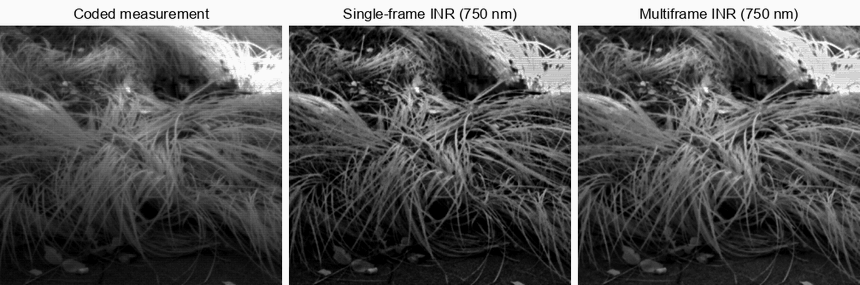
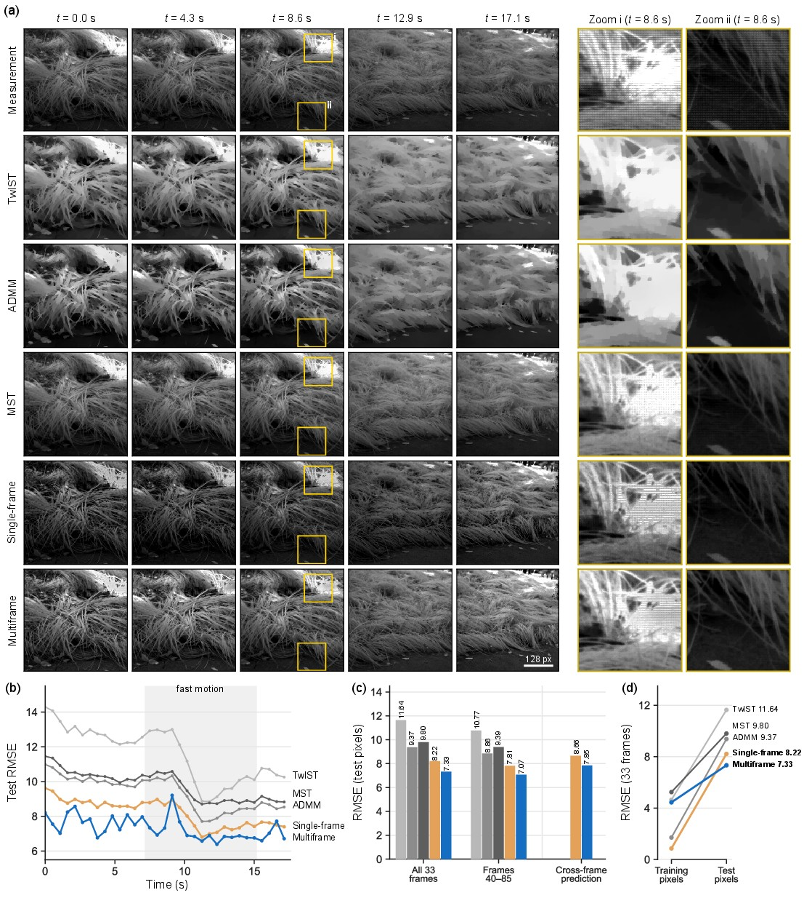
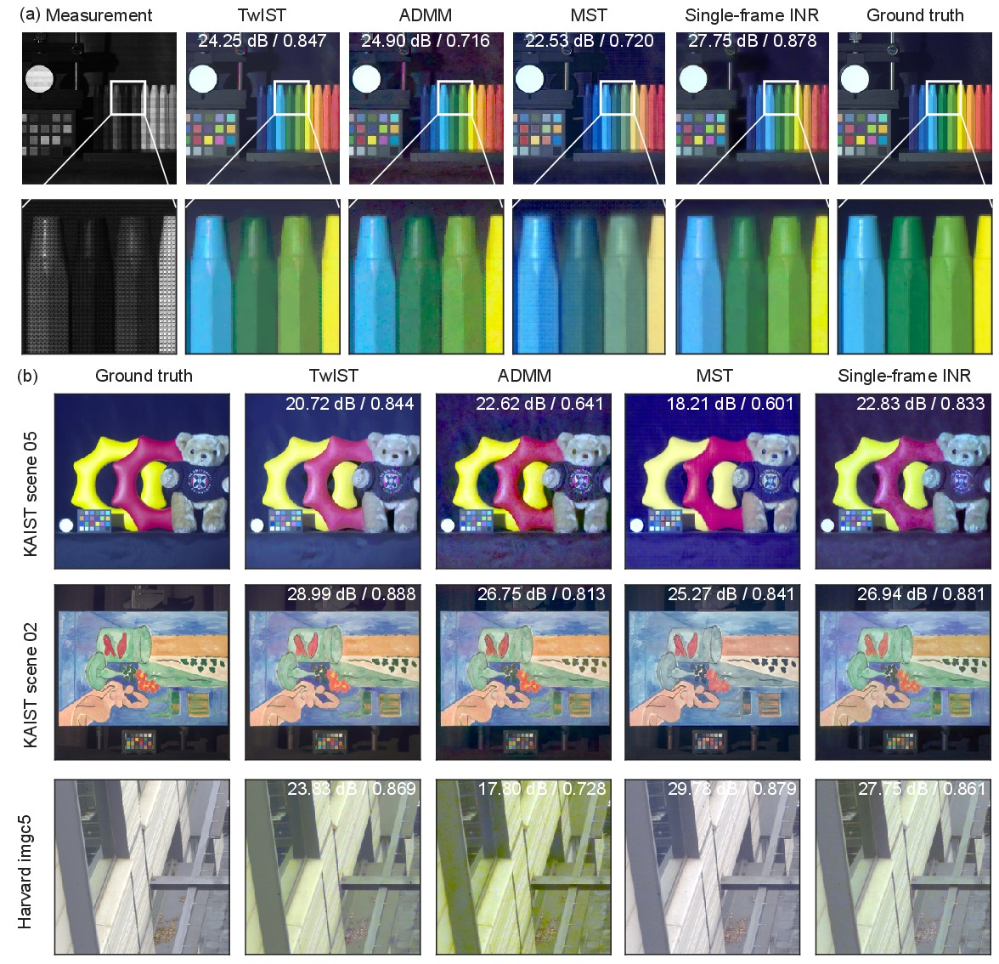
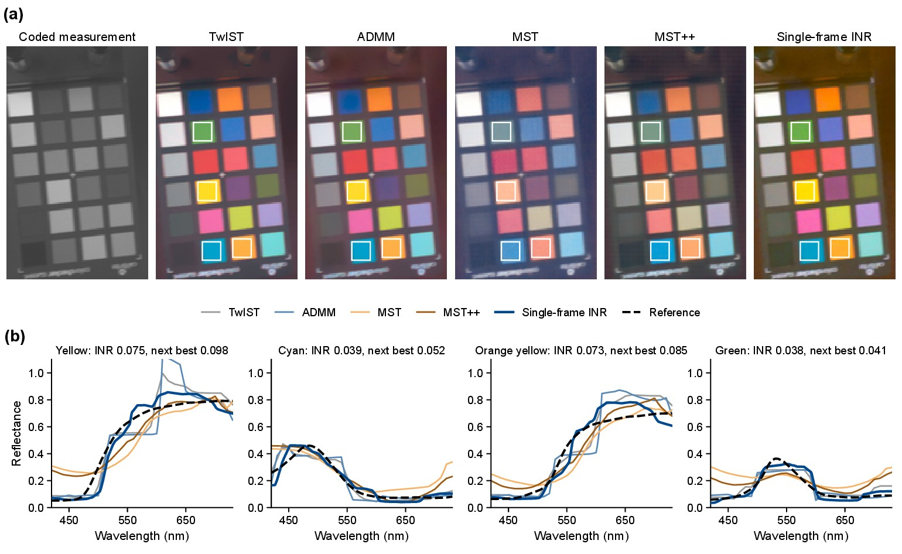

<div align="center">

# Dynamic Computational Spectral Imaging<br>with Implicit Neural Spectral Fields

**Jinwen Wei · Xinyu Liu · Shuhe Zhang · Liangcai Cao**

State Key Laboratory of Precision Measurement Technology and Instruments<br>
Department of Precision Instrument, Tsinghua University

[](#citation)
[](https://github.com/THUHoloLab/INSF)
[](LICENSE)



<sub>A moving scene recorded by a filter-array spectral camera at 5.6 frames per second, reconstructed with 601 spectral channels (350–950 nm). The 750-nm band is shown.</sub>

</div>

---

## Overview

A filter-array spectral camera compresses a 601-channel spectral datacube into one coded grayscale
frame. **INSF** represents the scene as an *implicit neural spectral field*: a compact coordinate
network that maps a position and a wavelength to a non-negative spectral intensity and is optimized
directly on the coded measurements of each scene, without pretraining or training data.

<p align="center"></p>

<table>
<tr>
<td align="center" width="25%"><h3>−31.8%</h3>test error of one field shared by 80 frames of a static scene, relative to a single frame</td>
<td align="center" width="25%"><h3>−10.8%</h3>test error of motion-compensated multiframe reconstruction on a moving scene</td>
<td align="center" width="25%"><h3>62×</h3>fewer parameters than voxels: a 98-frame spectral video in 1 GB instead of 62 GB</td>
<td align="center" width="25%"><h3>0 training data</h3>the field is fitted to each measurement and transfers across datasets</td>
</tr>
</table>

## Dynamic spectral imaging

Each frame is fitted jointly with its four neighbours, aligned by an optical-flow warp that is refined
during optimization. The neighbouring coded frames constrain what a single frame leaves undetermined:
the multiframe field predicts pixels that were never used for fitting more accurately than the
single-frame field and than TwIST, ADMM and the supervised MST network.

<p align="center"></p>

## Simulated measurements with ground truth

On coded measurements simulated from the KAIST, CAVE and Harvard datasets, the training-free INR keeps
its accuracy across datasets, whereas a supervised network loses about 10 dB of cube PSNR outside its
training distribution.

<p align="center"></p>

## Real captures of a colour chart

A ColorChecker chart and a white tile recorded under a 6,500 K illuminant, with the reflectance of the
patches compared with the published reference (a selected frame and four selected patches).

<p align="center"></p>

## Getting started

<details>
<summary><b>Installation</b></summary>

```bash
conda create -n insf python=3.12 && conda activate insf
pip install torch --index-url https://download.pytorch.org/whl/cu128          # match your CUDA
pip install git+https://github.com/NVlabs/tiny-cuda-nn/#subdirectory=bindings/torch
pip install -e .
```
</details>

<details>
<summary><b>Usage</b></summary>

```bash
python main.py                                                                   # list all commands
python main.py reconstruct shared-field --config configs/move1_shared.yaml       # static scene
python main.py reconstruct mc-window   --config configs/move2_mc_window.yaml     # moving scene
```

Every experiment of the paper has a configuration file in [`configs/`](configs). The measurements and
the coded mask of the camera are not distributed with the code; see [`data/README.md`](data/README.md).
</details>

## Citation

```bibtex
@article{wei2026insf,
  title   = {Dynamic Computational Spectral Imaging with Implicit Neural Spectral Fields},
  author  = {Wei, Jinwen and Liu, Xinyu and Zhang, Shuhe and Cao, Liangcai},
  year    = {2026}
}
```

<div align="center"><sub>Released under the <a href="LICENSE">MIT License</a>.</sub></div>
