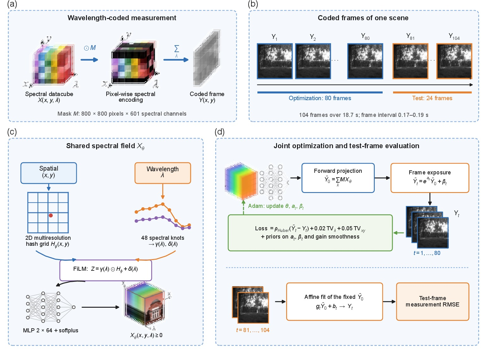

<div align="center">

# Dynamic Computational Spectral Imaging<br>with Implicit Neural Spectral Fields

**Jinwen Wei · Xinyu Liu · Shuhe Zhang · Liangcai Cao**

State Key Laboratory of Precision Measurement Technology and Instruments<br>
Department of Precision Instrument, Tsinghua University

[](#citation)
[](LICENSE)

</div>

<p align="center"></p>

A filter-array spectral camera compresses a 601-channel spectral datacube (350–950 nm) into one coded
grayscale frame. **INSF** represents the scene as an implicit neural spectral field, a compact
coordinate network that maps a position and a wavelength to a non-negative spectral intensity and is
optimized directly on the coded measurements of each scene, without pretraining or training data.
Fitting the field to several coded frames, aligned by optical flow when the scene moves, enables
static and dynamic spectral imaging.

## Getting started

```bash
pip install torch --index-url https://download.pytorch.org/whl/cu128          # match your CUDA
pip install git+https://github.com/NVlabs/tiny-cuda-nn/#subdirectory=bindings/torch
pip install -e .

python main.py                                                                   # list all commands
python main.py reconstruct shared-field --config configs/move1_shared.yaml       # static scene
python main.py reconstruct mc-window   --config configs/move2_mc_window.yaml     # moving scene
```

The measurements and the coded mask of the camera are not distributed with the code
(see [`data/README.md`](data/README.md)).

## Citation

```bibtex
@article{wei2026insf,
  title   = {Dynamic Computational Spectral Imaging with Implicit Neural Spectral Fields},
  author  = {Wei, Jinwen and Liu, Xinyu and Zhang, Shuhe and Cao, Liangcai},
  year    = {2026}
}
```

<div align="center"><sub>Released under the <a href="LICENSE">MIT License</a>.</sub></div>
